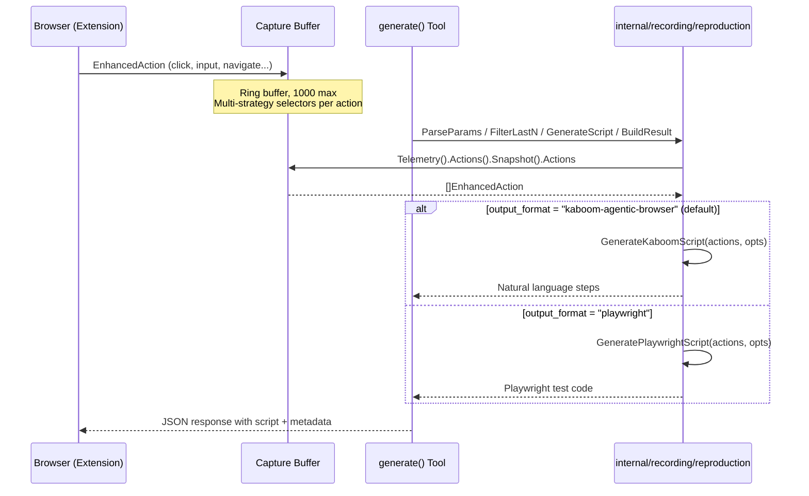

# Tech Spec: Reproduction Scripts

## Overview

`generate({format: "reproduction"})` produces reproduction scripts from captured `EnhancedAction` data. Two output formats: Playwright (test code) and Kaboom (natural language, `output_format: "kaboom-agentic-browser"`, the default).

The generate boundary is `Dispatcher.getReproductionScript()` in [dispatcher.go](../../../../internal/tools/generate/handler/dispatcher.go). It is a thin adapter: parsing, filtering, script generation and result assembly live in the `internal/recording/reproduction` package (`internal/recording/reproduction/reproduction.go`, `reproduction_kaboom.go`, `reproduction_playwright.go`, `reproduction_selectors.go`, `reproduction_locators.go`, `reproduction_utils.go`).

---

## Architecture

### Data Flow



### Selector Data Available Per Action

Each `EnhancedAction` arrives from the extension with a `Selectors` map containing multi-strategy selectors computed by `computeSelectors()` in `reproduction.ts`:

```
Selectors: {
  "testId":    "coupon-input",              // data-testid attribute
  "ariaLabel": "Enter coupon code",         // aria-label attribute
  "role":      {"role": "textbox", "name": "Enter coupon code"},  // ARIA role + name
  "id":        "coupon",                    // element ID
  "text":      "Apply",                     // visible text (clickables only)
  "cssPath":   "form > div.coupon > input"  // CSS path fallback
}
```

The generation code reads from this map to produce the best possible description for each format.

---

## Implementation

### Generate Boundary: `internal/tools/generate/handler/dispatcher.go`

`Dispatcher.getReproductionScript()` validates `output_format` (rejecting anything other than `kaboom-agentic-browser` or `playwright` with `invalid_param`), reads `Capture.Telemetry().Actions().Snapshot().Actions`, and delegates to `package reproduction` in `internal/recording/reproduction/`.

### Core Functions

#### 1. `getReproductionScript()` + `reproduction.ParseParams()` — Entry Point

Parses parameters, fetches actions, dispatches to the format-specific generator.

```go
type Params struct {
    Format            string `json:"format"`             // always "reproduction"
    OutputFormat      string `json:"output_format"`      // "kaboom-agentic-browser" (default) | "playwright"
    LastN             int    `json:"last_n"`             // optional: filter to last N actions
    BaseURL           string `json:"base_url"`           // optional: rewrite origins
    IncludeScreenshots bool  `json:"include_screenshots"` // optional: screenshot steps (playwright)
    ErrorMessage      string `json:"error_message"`      // optional: error context
}

type Result struct {
    Script      string              `json:"script"`
    Format      string              `json:"format"`
    ActionCount int                 `json:"action_count"`
    DurationMs  int64               `json:"duration_ms"`
    StartURL    string              `json:"start_url"`
    Metadata    Meta                `json:"metadata"`
}

type Meta struct {
    GeneratedAt           string         `json:"generated_at"`
    SelectorsUsed         []string       `json:"selectors_used"`
    ActionsAvailable      int            `json:"actions_available"`
    ActionsIncluded       int            `json:"actions_included"`
    FallbackOrder         []string       `json:"fallback_order"`   // selector, ax, coordinate
    LocatorCoverage       map[string]int `json:"locator_coverage"`
    EnvironmentPinned     bool           `json:"environment_pinned"`
    EnvironmentPinChanged bool           `json:"environment_pin_changed,omitempty"`
}
```

##### Flow:
1. `ParseParams(args)` (defaults `output_format` to `kaboom-agentic-browser`), then `ValidateOutputFormat()`
2. Read `h.deps.Capture.Telemetry().Actions().Snapshot().Actions`
3. `FilterLastN()` applies the `last_n` filter (slice from end)
4. `GenerateScript()` dispatches to `GenerateKaboomScript()` or `GeneratePlaywrightScript()`
5. `BuildResult()` computes metadata (duration, selectors used, counts, locator coverage, environment pin)
6. Return `Result`

#### 2. `GenerateKaboomScript()` — Natural Language

Converts actions to numbered human-readable steps.

```go
func GenerateKaboomScript(actions []types.EnhancedAction, opts Params) string
```

##### Algorithm:
1. Write header: `# Reproduction: {description}\n# Captured: {time} | {count} actions | {url}\n`
2. For each action:
   a. Check timing gap from previous action → insert `[Ns pause]` if > 2s
   b. Build element description via `DescribeElement(action)` (see below)
   c. Format step based on action type:
      - `navigate` → `Navigate to: {url}`
      - `click` → `Click: {description}`
      - `input` → `Type "{value}" into: {description}`
      - `select` → `Select "{text}" from: {description}`
      - `keypress` → `Press: {key}`
      - `scroll` → `Scroll to: y={position}`
3. If `error_message` provided → append `\n# Error: {message}`

#### 3. `DescribeElement()` — Human-Readable Element Description

Converts multi-strategy selectors into the most readable description possible.

```go
func DescribeElement(action types.EnhancedAction) string
```

##### Priority chain (first match wins):

| Priority | Condition | Output | Example |
|----------|-----------|--------|---------|
| 1 | `text` + `role.role` | `"{text}" {role}` | `"Submit" button` |
| 2 | `ariaLabel` + `role.role` | `"{ariaLabel}" {role}` | `"Close dialog" button` |
| 3 | `role.name` + `role.role` | `"{name}" {role}` | `"Email" textbox` |
| 4 | `testId` | `[data-testid="{testId}"]` | `[data-testid="coupon-input"]` |
| 5 | `text` alone | `"{text}"` | `"Add to Cart"` |
| 6 | `ariaLabel` alone | `"{ariaLabel}"` | `"Enter coupon code"` |
| 7 | `id` | `#{id}` | `#quantity` |
| 8 | `cssPath` | `{cssPath}` | `form > div > input` |
| 9 | (none) | `(unknown element)` | `(unknown element)` |

##### Why this order:
- Priorities 1-3 produce the most natural descriptions ("Submit" button reads like English)
- Priority 4 (testId) is machine-stable but less readable
- Priorities 5-6 are readable but without role context
- Priorities 7-8 are technical fallbacks

#### 4. `GeneratePlaywrightScript()` — Playwright Test

Converts actions to a Playwright test using the best available Playwright locator.

```go
func GeneratePlaywrightScript(actions []types.EnhancedAction, opts Params) string
```

##### Locator priority (matches Playwright best practices):

| Priority | Selector | Playwright Locator |
|----------|----------|-------------------|
| 1 | `testId` | `page.getByTestId('...')` |
| 2 | `role` + `name` | `page.getByRole('...', { name: '...' })` |
| 3 | `ariaLabel` | `page.getByLabel('...')` |
| 4 | `text` | `page.getByText('...')` |
| 5 | `id` | `page.locator('#...')` |
| 6 | `cssPath` | `page.locator('...')` |

##### Action mapping:

| Action | Playwright Code |
|--------|----------------|
| `click` | `await page.{locator}.click();` |
| `input` | `await page.{locator}.fill('{value}');` |
| `navigate` | `await page.goto('{url}');` |
| `select` | `await page.{locator}.selectOption('{value}');` |
| `keypress` | `await page.keyboard.press('{key}');` |
| `scroll` | `// Scroll to y={position}` |

**Timing:** Pauses > 2s rendered as `// [{N}s pause]` comments.

**URL rewriting:** If `base_url` provided, all URLs rewritten: extract pathname, prepend base_url.

---

## Edge Cases

### E1: No Actions Captured

**Trigger:** `Actions().Snapshot().Actions` returns an empty slice.
**Resolution:** No error is returned; the Kaboom generator emits `# No actions captured` and the result reports `action_count: 0`.

### E2: All Selectors Missing

**Trigger:** Action has nil/empty `Selectors` map.
**Resolution:** `DescribeElement()` returns `(unknown element)`. Playwright generator emits comment `// action - no selector available`.

### E3: Redacted Input Values

**Trigger:** `action.Value == "[redacted]"` (sensitive field like password).
**Resolution:** Kaboom: `Type "[user-provided]" into: Password field`. Playwright: `await page.{locator}.fill('[user-provided]');`.

### E4: Very Long Scripts (1000 actions)

**Trigger:** Full buffer with 1000 actions.
**Resolution:** The Playwright script is hard-capped at 200KB (`maxReproOutputBytes`); output beyond the cap is cut off. Use `last_n` to keep the most recent actions.

### E5: URL Rewriting with base_url

**Trigger:** `base_url` parameter provided.
**Resolution:** For each URL, extract pathname and prepend base_url. If URL parsing fails, use as-is.

### E6: Special Characters in Values

**Trigger:** User typed text containing quotes, backslashes, newlines.
**Resolution:** Escape for Playwright (`'` → `\'`, `\n` → `\\n`). Kaboom uses double-quoted values which handle most cases naturally; newlines rendered as `\n`.

### E7: Navigate Actions with No URL

**Trigger:** `action.ToURL` is empty.
**Resolution:** Skip the action in output (don't emit an empty navigate step).

### E8: Mixed Human and AI Actions

**Trigger:** Buffer contains both `Source: "human"` and `Source: "ai"` actions.
**Resolution:** Include all actions. AI actions annotated with `(AI)` prefix in Kaboom format: `3. (AI) Click: "Submit" button`. No annotation in Playwright.

---

## Selector Extraction Helpers

The `Selectors` map from the extension uses `map[string]any` in Go. Helper functions extract typed values safely:

```go
func selectorStr(selectors map[string]any, key string) string {
    v, ok := selectors[key].(string)
    if !ok { return "" }
    return v
}

func selectorRole(selectors map[string]any) (role, name string) {
    roleData, ok := selectors["role"]
    if !ok { return "", "" }
    roleMap, ok := roleData.(map[string]any)
    if !ok { return "", "" }
    role, _ = roleMap["role"].(string)
    name, _ = roleMap["name"].(string)
    return role, name
}
```

---

## Files

| File | Role |
|------|------|
| `internal/tools/generate/handler/dispatcher.go` | Generate adapter (`getReproductionScript`) |
| `internal/recording/reproduction/reproduction.go` | Params, result, validation, dispatch, metadata |
| `internal/recording/reproduction/reproduction_kaboom.go` | Kaboom natural-language generator |
| `internal/recording/reproduction/reproduction_playwright.go` | Playwright generator |
| `internal/recording/reproduction/reproduction_selectors.go` | `DescribeElement`, `PlaywrightLocator`, selector helpers |
| `internal/recording/reproduction/reproduction_locators.go` | Fallback locators (selector, AX, coordinate) and environment pin |
| `internal/recording/reproduction/reproduction_utils.go` | Escaping, URL rewriting, truncation helpers |

---

## Testing Strategy

### Unit Tests

`internal/recording/reproduction/reproduction_test.go` covers the format behaviours, including:

1. **TestReproduction_Kaboom_BasicFlow** / **AllActionTypes** / **ElementDescriptionPriority** / **TimingPauses** / **RedactedValues** / **AIActions** / **ErrorMessage**
2. **TestReproduction_Playwright_BasicFlow** / **LocatorPriority** / **URLRewriting** / **SpecialCharacters** / **TimingPauses**
3. **TestReproduction_EmptyActions**, **TestReproduction_LastN**, **TestReproduction_DefaultFormat**
4. Per-step `TestPlaywrightStep_*` cases

`internal/recording/reproduction/reproduction_locators_test.go` covers fallback locators and environment pinning; `internal/recording/reproduction/golden_test.go` compares Playwright output against golden files. `internal/recording/actionlog/reproselector_test.go` covers selector parsing for reproduction.

### Integration Test

`internal/tools/generate/handler/toolgenerate_test.go` exercises the generate dispatch so the `reproduction` format reaches `package reproduction`.

---

## Performance

| Metric | Target | Rationale |
|--------|--------|-----------|
| Generation time | < 50ms for 1000 actions | Single pass, string builder, no I/O |
| Output size | < 200KB | Capped by truncation |
| Memory | < 2MB transient | Actions already in buffer; script is one string allocation |

---
